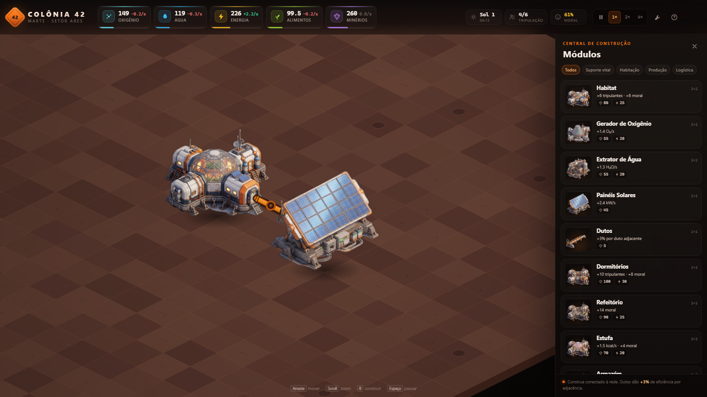
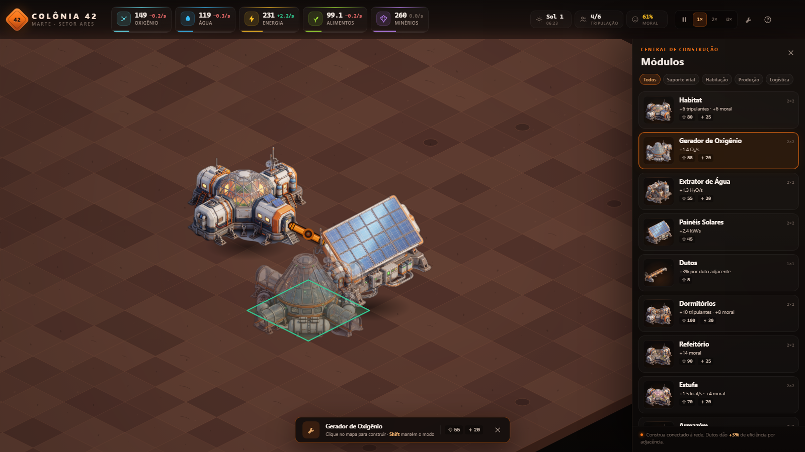
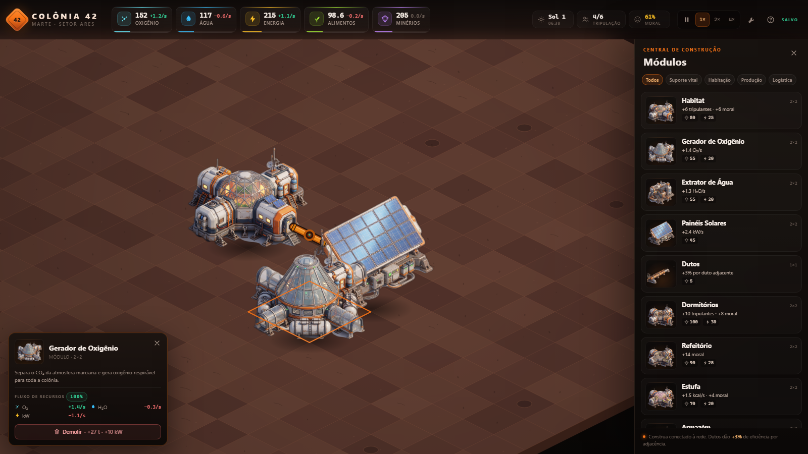
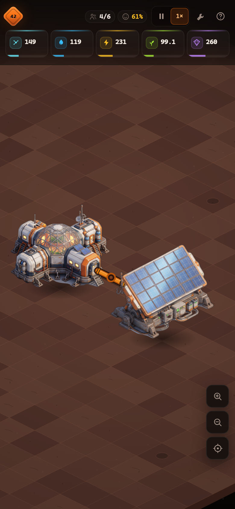
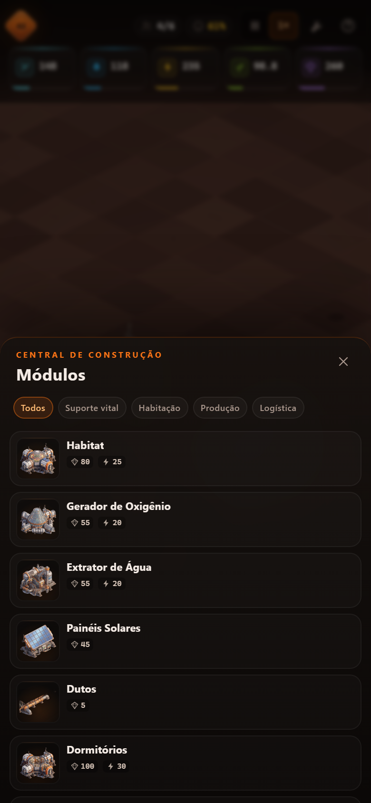

# Colônia 42 · Marte

Jogo **idle / de gerenciamento de colônia** em 2D isométrico, feito com HTML5 Canvas, JavaScript puro (ES Modules) e CSS. Sem frameworks, sem build: abra um servidor local e jogue.

A colônia começa com um módulo de pouso, dois trechos de duto e um painel solar. A partir daí, o jogador precisa equilibrar **oxigênio, água, energia, alimentos e minérios**, expandir a rede de módulos e manter a tripulação viva — enquanto a produção continua mesmo com a aba fechada.

**▶ Jogue online:** <https://marciomoura2022.github.io/colonia-42-marte/>



## Destaques

- **Mapa isométrico 24 × 24** desenhado em Canvas 2D, com câmera panorâmica e zoom.
- **12 módulos** com custos, produção, consumo, habitação e moral próprios.
- **Simulação por segundo** de cinco recursos, com capacidade de armazenamento e desperdício no limite.
- **Rede de construção**: novos módulos precisam encostar na colônia; dutos adjacentes dão bônus de eficiência.
- **Apagão, moral e população**: energia insuficiente reduz a produção; moral baixa acelera a queda de tripulantes; moral alta favorece o crescimento.
- **Progresso offline** (até 8 h, com 50% de eficiência) e **autosave** em `localStorage`.
- **Interface responsiva** para desktop, tablet e celular, com painel de construção em gaveta no mobile.
- **Sprites recortados** dos renders conceituais originais, com pipeline de preparação reproduzível.
- Código modular e comentado em português, sem dependências de runtime.

## Como rodar

O jogo usa ES Modules, então **não funciona abrindo `index.html` diretamente** (`file://`). É necessário servir a pasta por HTTP.

**Requisitos:** navegador moderno com suporte a Canvas 2D e ES Modules. Para o servidor local, Python 3 ou Node.js (apenas no desenvolvimento; o jogo não tem dependências de runtime).

### Windows

Dê dois cliques em [`start.bat`](start.bat). Ele inicia um servidor Python na porta 8080 e abre o navegador.

### Qualquer sistema

```bash
# Python 3
python -m http.server 8080

# ou Node.js
npx serve .
```

Depois acesse <http://127.0.0.1:8080/>.

> Alternativa: use a extensão **Live Server** do VS Code na raiz do projeto.

## Controles

| Ação | Desktop | Mobile |
| --- | --- | --- |
| Mover a câmera | Arrastar com o mouse | Arrastar com um dedo |
| Zoom | Scroll do mouse ou botões `+` / `−` | Pinça ou botões `+` / `−` |
| Construir | Tecla `B` ou ícone de ferramenta | Ícone de ferramenta |
| Posicionar módulo | Clicar no mapa | Tocar no mapa |
| Manter modo de construção | `Shift` + clique | — |
| Inspecionar módulo | Clicar no módulo | Tocar no módulo |
| Demolir | `Delete` no módulo selecionado | Botão **Demolir** no inspetor |
| Pausar / retomar | `Espaço` | Botão de pausa |
| Velocidade 1× / 2× / 4× | Teclas `1` / `2` / `3` | Botão de velocidade (alterna) |
| Mostrar/ocultar grade | `G` | — |
| Ajuda e opções | `H` ou `?` | Ícone de interrogação |
| Cancelar / fechar | `Esc` | Botão de fechar |

O botão **Salvar agora** e a opção de reiniciar a colônia ficam na janela de ajuda.

## Mecânicas

### Recursos

| Recurso | Uso principal | Capacidade inicial |
| --- | --- | --- |
| Oxigênio (O₂) | Tripulação e módulos pressurizados | 500 |
| Água (H₂O) | Consumo, estufas e gerador de oxigênio | 400 |
| Energia (kW) | Quase todos os módulos | 600 |
| Alimentos (kcal) | Tripulação e refeitório | 350 |
| Minérios (t) | Construção, fábrica e oficina | 600 |

Cada colono consome **0,03 O₂/s**, **0,035 H₂O/s** e **0,045 kcal/s**. Quando um recurso chega a zero, a colônia emite alertas e a moral cai.

### Módulos

| Módulo | Custo | Efeito |
| --- | --- | --- |
| Habitat | 80 t · 25 kW | +6 tripulantes, +6 moral |
| Gerador de Oxigênio | 55 t · 20 kW | +1,4 O₂/s |
| Extrator de Água | 55 t · 20 kW | +1,3 H₂O/s |
| Painéis Solares | 45 t | +2,4 kW/s |
| Dutos | 5 t | +3% de eficiência por duto adjacente (máx. +15%) |
| Dormitórios | 100 t · 30 kW | +10 tripulantes, +8 moral |
| Refeitório | 90 t · 25 kW | +14 moral |
| Estufa | 70 t · 20 kW | +1,5 kcal/s, +4 moral |
| Armazém | 60 t · 15 kW | +capacidade de armazenamento |
| Fábrica | 110 t · 35 kW | +2,6 kW/s |
| Mina | 75 t · 25 kW | +1,6 t/s |
| Oficina | 95 t · 30 kW | +5% de eficiência global (máx. +25%) |

Os custos completos, consumos e descrições ficam em [`js/config.js`](js/config.js).

### Rede, eficiência e moral

- **Conexão obrigatória:** com a colônia já iniciada, um novo módulo precisa encostar em outro módulo ou duto.
- **Bônus de dutos:** cada duto encostado no footprint concede **+3%** de produção, até **+15%**.
- **Oficinas:** cada oficina concede **+5%** de produção global, até **+25%**.
- **Apagão:** com energia zerada e saldo negativo, a produção cai para **55%** até a energia voltar.
- **Moral:** parte de 55 e é ajustada por módulos, superlotação, falta de recursos e apagão.
  - Moral abaixo de 30: produção a **85%**.
  - Moral acima de 75: produção a **105%**.
- **População:** cresce com moral ≥ 45, espaço livre e recursos acima de 2 unidades. Sem comida ou oxigênio, a tripulação declina até o mínimo de 1 colono.
- **Demolição:** devolve **50%** do custo original.

### Progresso offline

Ao fechar ou recarregar a página, o tempo ausente é simulado com **50% de eficiência**, limitado a **8 horas**. Um resumo mostra as variações de recursos e avisa sobre recursos esgotados. A tripulação não morre durante o período offline; a decadência começa quando o jogador retorna.

O jogo também simula o período em que a aba fica em segundo plano e salva automaticamente a cada 20 segundos.

## Estrutura do projeto

```text
.
├─ index.html                  # Estrutura do HUD, painel, modais e canvas
├─ start.bat                   # Servidor local + abertura do navegador (Windows)
├─ css/
│  └─ style.css                # Tema, layout responsivo, HUD, painéis e modais
├─ js/
│  ├─ config.js                # Fonte única de verdade: grade, recursos, módulos, balanceamento
│  ├─ main.js                  # Boot, entrada, câmera, loop, save/offline e integração da UI
│  ├─ core/
│  │  ├─ AssetLoader.js        # Carregamento dos sprites com fallback
│  │  ├─ Camera.js             # Pan, zoom, limites e sugestão de zoom por tela
│  │  ├─ Colony.js             # Simulação, validação, rede, população e moral
│  │  ├─ GameLoop.js           # requestAnimationFrame, pausa e multiplicador de velocidade
│  │  ├─ ResourceManager.js    # Quantidades, capacidades, custos e reembolsos
│  │  └─ SaveManager.js        # Persistência versionada em localStorage
│  ├─ render/
│  │  └─ Renderer.js           # Terreno, tiles, sprites, dutos, seleção e fantasma
│  ├─ ui/
│  │  ├─ BuildMenu.js          # Cards, categorias e gaveta mobile
│  │  ├─ Hud.js                # Recursos, Sol, população, moral e velocidade
│  │  ├─ Inspector.js          # Detalhes do módulo e demolição
│  │  ├─ Toast.js              # Notificações
│  │  └─ icons.js              # Ícones SVG inline
│  └─ utils/
│     ├─ format.js             # Números, taxas, tempo e custos
│     └─ iso.js                # Conversões grade ↔ mundo ↔ tela
├─ assets/
│  ├─ *.jpg                    # Renders conceituais originais
│  └─ buildings/*.png          # Sprites recortados usados no jogo
├─ tools/
│  ├─ prepare_assets.py        # Pipeline de recorte e normalização dos sprites
│  └─ smoke-test.mjs           # Teste de fumaça e captura de screenshots (Playwright)
└─ docs/                       # Screenshots do README
```

### Fluxo de dados

1. `config.js` define recursos, módulos e constantes de balanceamento.
2. `Colony.update(dt)` calcula produção, consumo, apagão, moral e população.
3. `Hud`, `BuildMenu` e `Inspector` leem o estado da colônia e atualizam o DOM.
4. `Renderer` desenha o terreno isométrico, os sprites e as sobreposições de construção.
5. `SaveManager` serializa o estado a cada 20 s, ao sair da aba e ao fechar a página.

## Interface

| Posicionamento | Inspeção |
| --- | --- |
|  |  |

<p align="center">
  
  
</p>

## Assets

Os renders originais em `assets/*.jpg` têm fundo de estúdio e foram convertidos para PNGs com transparência por [`tools/prepare_assets.py`](tools/prepare_assets.py), usando **rembg (u2net)**. O script também recorta a margem, redimensiona e adiciona padding uniforme.

```bash
pip install rembg onnxruntime pillow numpy
python tools/prepare_assets.py
```

Os PNGs gerados já estão versionados, então **não é preciso Python para jogar**. Para adicionar um novo módulo:

1. Coloque o PNG em `assets/buildings/`.
2. Adicione a definição em `BUILDINGS` (`js/config.js`).
3. Inclua o id em `BUILDING_ORDER`.
4. Ajuste `spriteScale` e `anchor` se o sprite não encaixar no footprint.

Os dutos são desenhados proceduralmente no mapa (para acompanhar a rede); o PNG do duto é usado apenas no card do menu.

## Testes

O teste de fumaça usa Playwright e precisa do servidor local rodando:

```bash
npm install --no-save playwright
node tools/smoke-test.mjs
```

Ele valida o boot, o posicionamento e construção de um módulo, a abertura do inspetor, pausa, velocidade e save, além de gerar as capturas em `docs/`.

## Balanceamento

Todos os números de gameplay ficam em [`js/config.js`](js/config.js):

- `RESOURCES` — valores iniciais e capacidades;
- `BUILDINGS` — custos, produção, consumo, habitação, moral e armazenamento;
- `BALANCE` — consumo por colono, crescimento, eficiência, bônus de rede, reembolso e offline;
- `STARTING_LAYOUT` — colônia inicial.

## Roadmap

- Variação de produção solar entre dia e noite.
- Eventos aleatórios (tempestades de poeira, avarias, suprimentos).
- Árvore de pesquisa e especializações de módulos.
- Som ambiente e feedback sonoro.
- Múltiplos slots de save e exportação do progresso.
- Localização em inglês.

## Licença

Distribuído sob a licença [MIT](LICENSE).

Os renders conceituais em `assets/*.jpg` foram fornecidos para este projeto e mantêm seus créditos originais. O código pode ser reutilizado livremente nos termos da MIT.
